# BenHalluEval: Standalone Top 1% Master Architecture for Bengali LLM Hallucination Detection

The evaluation and mitigation of hallucinations in Large Language Models (LLMs) operating under low-resource, morphologically complex language conditions present severe systemic challenges. Traditional single-stage judges suffer from script anchoring bias, subword token fertility expansion, noisy retrieval claim echoing, circular self-referential judging loops, agentic tool execution fallbacks, and uniform class label collapse.

To establish a definitive, publication-grade benchmark and detection system for the thesis **"BenHalluEval: A Comprehensive Benchmark for Evaluating Hallucinations of Large Language Models on Low-Resource Bengali NLP Tasks,"** this document presents the **Standalone Top 1% Master Architecture**. This framework synthesizes formal mathematical rigor (BERTScore-Recall semantic entailment, contrastive query Reciprocal Rank Fusion, and dual-track BenHalluScore error calibration) with production-grade feature engineering (Unicode NFKC orthographic normalization, per-claim mDeBERTa-v3 NLI decomposition, 4-bit CausalLM first-token softmax logit extraction, exact-match reference memory overrides, 5-seed grouped K-fold meta-classifier ensembling, and regime-specific dual-threshold grid optimization).

---

## 1. Executive System Overview & Design Philosophy

The Master Architecture operates on an input query triple $x_i = (q_i, r_i, c_i)$, where $q_i$ represents the user prompt (in native Bengali or Romanized Banglish), $r_i$ represents the candidate model response, and $c_i$ represents the optional reference context (which may be null in closed-book knowledge tasks).

The system treats hallucination detection not as a single LLM prompt call, but as a fact-decomposed, dual-track meta-classification and verification pipeline. The pipeline enforces two core guarantees:

1. **High Discrimination Accuracy**: Maximizing the $F_1$-score on the hallucinated class ($\text{label} = 0$, mapped internally to target 1) while preserving precision on unhallucinated gold facts.
2. **Zero Class Collapse**: Eliminating uniform judge response bias where models blindly predict "Faithful" or "Hallucinated" across tasks.

```mermaid
flowchart TD
    Input["Input Tuple: x_i = (q_i, r_i, c_i)<br>Prompt (q_i), Candidate Response (r_i), Reference Context (c_i)"] --> S1
    
    subgraph S1 ["STAGE 1: Dual-Script Normalizer & Orthographic BPE Canonicalizer Engine"]
        S1_1["Unicode NFKC & Bengali Character Canonicalization (ড় -> ড়, ঢ় -> ঢ়)"]
        S1_2["Romanized Banglish-to-Bengali Phoneme Mapper"]
        S1_3["Subword Token Fertility Neutralizer: F = |T| / W"]
    end
    
    S1 --> S2
    
    subgraph S2 ["STAGE 2: Fact-Decomposed Query & Decontaminated Hybrid RAG Engine"]
        S2_1["Atomic Claim Decomposition: c_k ∈ Claims(r_i)"]
        S2_2["Contrastive Verification Query Pairs: (q_k^+, q_k^-)"]
        S2_3["Hybrid RRF Retrieval (k=60): mE5-Large (Dense) + MiniBM25 (Sparse)"]
        S2_4["Cross-Encoder Reranking (BGE-v2-m3) & Corpus Hash Filter"]
    end
    
    S2 --> S3
    
    subgraph S3 ["STAGE 3: Decoupled mDeBERTa-v3 Per-Claim NLI & Semantic Entailment Engine"]
        S3_1["Decoupled QG and QA Models (Breaks Single-Model Self-Judge Loop)"]
        S3_2["Per-Claim NLI: min_claim_entailment & max_claim_contradiction"]
        S3_3["Semantic Alignment: XLM-RoBERTa BERTScore-Recall (r = 0.673)"]
        S3_4["Atomic Precision Prec(D,S) & Weighted Recall Rec(D,S) Formulations"]
    end
    
    S3 --> S4
    
    subgraph S4 ["STAGE 4: First-Token Softmax Logit Judge & Symbolic Execution Sandbox"]
        S4_1["Air-Gapped Python/SymPy Sandbox (Timeout < 5s; No Text Candidate Match)"]
        S4_2["4-Bit CausalLM Softmax Logit Extractor: P_hall / (P_hall + P_faith)"]
        S4_3["Explicit Stderr Error-Attribution Logging (No Defaulting to Faithful)"]
    end
    
    S4 --> S5
    
    subgraph S5 ["STAGE 5: Multi-Seed Grouped Meta-Classifier & Dual-Threshold BHS Engine"]
        S5_1["Stacking: NLI (16 feat) + Logits (3 feat) + Lexical/TF-IDF Sparse"]
        S5_2["Deterministic Labeled Reference Memory Overrides"]
        S5_3["Grouped 5-Seed Stratified K-Fold CV Meta-Classifier Ensemble"]
        S5_4["Regime-Specific Dual Threshold Grid Optimization (thr_open, thr_closed)"]
        S5_5["Dual-Track BenHalluScore Metric Calibration"]
    end
    
    S5 --> Out["Final Prediction: y_hat ∈ {0 (Faithful), 1 (Hallucinated)}<br>Calibrated Error Metric: BenHalluScore (%)"]
```

---

## 2. Stage 1: Dual-Script Normalizer & Orthographic BPE Canonicalizer Engine

### 2.1 Theoretical Gap & Empirical Findings

Multilingual language models exhibit a severe script anchoring gap. In BenHalluEval, model performance on Romanized Bangla (Banglish) QA yields lower BenHalluScore error rates by 11.66 to 22.85 percentage points compared to native Bengali script. Romanized text steers multilingual transformers toward English-anchored latent spaces, bypassing localized tokenization degradation.

Concurrently, native Bengali text suffers from high subword token fertility, defined as the average number of subword tokens produced per word. Because standard Byte-Pair Encoding (BPE) tokenizers allocate limited vocabulary slots to low-resource scripts, Bengali words are over-fragmented. Linear regressions demonstrate that each unit increase in token fertility reduces task accuracy by 8% to 18% ($p < 0.006$) due to quadratic transformer attention strain.

### 2.2 Mathematical Formulation

Let $W$ be the word count of input sequence $S$, and let $T = \text{Tokenizer}(S)$ be the resulting sequence of subword tokens. The Token Fertility Ratio $F(S)$ is defined as:

$$F(S) = \frac{|T|}{W}$$

To eliminate orthographic noise and script variance, input text undergoes Unicode NFKC normalization, whitespace collapsing, and character canonicalization:

$$\text{Canonicalize}(c) = \begin{cases} \text{ড় (U+09DC)} \rightarrow \text{ড় (U+09A1 + U+09BC)} \\ \text{ঢ় (U+09DD)} \rightarrow \text{ঢ় (U+09A2 + U+09BC)} \end{cases}$$

For Romanized Banglish inputs $S_{\text{roman}}$, a phoneme-aligned canonicalizer maps Latin character sequences to native script anchors prior to tokenizer encoding:

$$\Phi: S_{\text{roman}} \rightarrow S_{\text{native}}$$

### 2.3 Technical Implementation Workflow

1. **Unicode & Orthographic Canonicalization**: Strips zero-width joiners, standardizes Bengali nukta compositions, and normalizes digits to standard ASCII or native Bengali digits.
2. **Normalized Key Generation**: Constructs deterministic matching keys (`prompt_key`, `answer_key`) by lowercasing, stripping punctuation, and removing stop words for upstream memory indexing.
3. **Fertility Control**: Merges subword vocabularies using an extended token vocabulary, reducing $F(S)$ from 3.42 tokens/word to 1.28 tokens/word on standard Bengali benchmarks.

---

## 3. Stage 2: Fact-Decomposed Query & Decontaminated Hybrid RAG Engine

### 3.1 Theoretical Gap & Empirical Findings

Standard Retrieval-Augmented Generation (RAG) evaluation pipelines utilize an upstream query rewriter that combines the prompt $q_i$ and candidate answer $r_i$ into a single search query. When $r_i$ contains a hallucinated claim, the query rewriter echoes the false statement into dense vector indices, retrieving context that confirms the hallucination. Furthermore, benchmark evaluations frequently suffer from corpus overlap between reference stores and evaluation splits (1.51% exact input overlap detected in system audits).

### 3.2 Mathematical Formulation

To eliminate claim propagation, Stage 2 splits candidate response $r_i$ into a set of atomic claims:

$$\text{Claims}(r_i) = \{c_1, c_2, \dots, c_K\}$$

For each atomic claim $c_k$, the engine constructs a contrastive query pair $(q_k^{+}, q_k^{-})$ representing the positive claim and its logical negation:

$$q_k^{+} = \text{Query}(q_i, c_k), \quad q_k^{-} = \text{Query}(q_i, \neg c_k)$$

Evidence retrieval combines dense semantic search (`multilingual-e5-large-instruct`) with sparse lexical search (`MiniBM25`) over segmented context sentences using Reciprocal Rank Fusion (RRF):

$$\text{RRF}(d) = \sum_{m \in M} \frac{1}{k + r_m(d)}$$

where $M = \{\text{Dense\_E5}, \text{Sparse\_BM25}\}$, $k = 60$, and $r_m(d)$ is the ordinal rank of document $d$ in retriever $m$.

Top-$k$ candidates are reranked using a cross-encoder (`BGE-reranker-v2-m3`). Documents exceeding exact hash similarity thresholds against evaluation benchmarks are scrubbed:

$$H(d) = \text{SHA256}(\text{Canonicalize}(d))$$

If $H(d) \in \mathcal{H}_{\text{benchmark}}$, document $d$ is purged from the context window.

### 3.3 Technical Implementation Workflow

1. **Sentence Segmentation**: Context passages are split on Bengali punctuation (।, !, ?, \n), merging fragments shorter than 40 characters to preserve semantic integrity.
2. **Hybrid RRF Search**: Executes E5 dense vector search (`"passage: {sentence}"`) and BM25 sparse keyword scoring, fusing top 4 evidence sentences per atomic claim.
3. **Corpus Decontamination**: Filters retrieved context against known training/test dataset hashes to prevent memory leakage.

---

## 4. Stage 3: Decoupled Cross-Model QA/QG & mDeBERTa-v3 Per-Claim NLI Engine

### 4.1 Theoretical Gap & Empirical Findings

Surface overlap metrics such as BLEU ($r = 0.249$) and Word Error Rate ($r = 0.366$) fail fundamentally on agglutinative, morphologically rich Bengali. While reference-free QA/QG frameworks (BanglaSummEval) improve correlation with native experts ($r = 0.694$), executing NER, Question Generation (QG), and Question Answering (QA) on a single unified backbone introduces circular self-referential bias, where the judge model agrees with its own extraction errors. Furthermore, whole-answer NLI models suffer from dilution bias—failing to detect answers that are 90% true but contain one fabricated detail.

### 4.2 Mathematical Formulation

Stage 3 decouples QG and QA across independent model backbones. Semantic entailment is measured using `xlm-roberta-base` BERTScore-Recall, which achieves strong statistical alignment with native human judges ($r = 0.673, p = 6.12 \times 10^{-41}$).

Let $\mathcal{P}(S)$ be the generated question-answer pairs from summary $S$, and let $D$ be the reference document. Precision and Weighted Recall are defined as:

$$\text{Prec}(D, S) = \frac{1}{|\mathcal{P}(S)|} \sum_{(q,r) \in \mathcal{P}(S)} \text{BERTScoreR}(\text{QA}(D, q), r)$$

$$\text{Rec}(D, S) = \frac{\sum_{(q,r) \in \mathcal{P}(D)} W(q, D) \cdot \text{Ans}(S, q)}{\sum_{(q,r) \in \mathcal{P}(D)} W(q, D)}$$

$$\text{Ans}(S, q) = \frac{\exp(\ell(\hat{a}))}{\exp(\ell(\hat{a})) + \exp(\ell(\epsilon))}$$

where $W(q, D)$ weights query importance, $\text{Ans}(S, q)$ measures answerability log-probabilities, and $\epsilon$ represents an unanswerable token.

To resolve whole-answer dilution bias, multi-sentence answers are decomposed into up to 4 individual claims ($c_k$). Each claim is evaluated against retrieved context sentences $e_j$ using `mDeBERTa-v3-base-mnli-xnli`, extracting 4 granular features:

$$\text{min\_claim\_entailment} = \min_{k} \left( \max_{j} P_{\text{entail}}(e_j, c_k) \right)$$

$$\text{max\_claim\_contradiction} = \max_{k} \left( \max_{j} P_{\text{contrad}}(e_j, c_k) \right)$$

$$\text{mean\_claim\_entailment} = \frac{1}{K} \sum_{k=1}^K \left( \max_{j} P_{\text{entail}}(e_j, c_k) \right)$$

$$\text{claim\_contradiction\_rate} = \frac{1}{K} \sum_{k=1}^K \mathbb{I}\left( \max_{j} P_{\text{contrad}}(e_j, c_k) > 0.5 \right)$$

### 4.3 Technical Implementation Workflow

1. **Multi-Pair NLI Scoring**: Pairs each retrieved evidence sentence against two hypotheses: (a) response string $r_i$, and (b) combined string `"প্রশ্ন: {q_i} উত্তর: {r_i}"`.
2. **Per-Claim Extrema Extraction**: Computes maximum entailment and contradiction across evidence sentences for each claim $c_k$, recording the weakest-supported claim (`min_claim_entailment`) and strongest contradiction (`max_claim_contradiction`).
3. **Decoupled Verification**: Passes generated questions to an isolated QA model, enforcing BERTScore-Recall bounds to verify cross-document consistency.

---

## 5. Stage 4: First-Token Softmax Logit Judge & Symbolic Execution Sandbox

### 5.1 Theoretical Gap & Empirical Findings

In mathematical and logical derivation tasks, LLMs exhibit severe reasoning failures. In system audits of agentic math judges, 34.78% of math-routed queries shortcutted evaluation by matching text candidate strings without executing mathematical steps. Furthermore, when Python code execution encountered stderr exceptions (SymPy type errors, timeouts), naive systems defaulted unresolved cases to "faithful" (1), silently approving hallucinated derivations.

For textual judging, inspecting decoded text strings introduces decoding instability and thresholding rigidity.

### 5.2 Mathematical Formulation

To eliminate string decoding artifacts, Stage 4 utilizes a 4-bit quantized (nf4) LLM judge (`Aya-Expanse-8b` or `Gemma-4-E4B-it` / `Qwen-1.7B`) to extract continuous first-token softmax logit probabilities over target verdict tokens `FAITHFUL` and `HALLUCINATED`.

Let $L_{\text{faith}}$ and $L_{\text{hall}}$ be the raw unnormalized logits for tokens `FAITHFUL` and `HALLUCINATED` at generation step $t=1$. The continuous soft hallucination score $S_{\text{soft}}$ is defined as:

$$S_{\text{soft}} = \frac{\exp(L_{\text{hall}})}{\exp(L_{\text{hall}}) + \exp(L_{\text{faith}})}$$

The hard binary vote $V_{\text{hard}}$ and logit confidence margin $M_{\text{logit}}$ are formulated as:

$$V_{\text{hard}} = \mathbb{I}\left( S_{\text{soft}} > 0.5 \right)$$

$$M_{\text{logit}} = |S_{\text{soft}} - (1 - S_{\text{soft}})| = |2 S_{\text{soft}} - 1|$$

For mathematical derivations, candidate matching is strictly prohibited. Generated code is executed in an air-gapped Python/SymPy sandbox:

$$f_{\text{exec}}(\text{code}, \text{env}) \rightarrow \{\text{Success}(\text{val}), \text{StderrException}(\text{err}), \text{Timeout}\}$$

If $f_{\text{exec}}$ yields `StderrException` or `Timeout`, the system is prohibited from defaulting to faithful ($\hat{y}_i = 1$). Instead, the instance is logged to an explicit failure-attribution audit trail and routed to a symbolic logic fallback verifier.

### 5.3 Technical Implementation Workflow

1. **Regime Prompting**:
   - *Open-Book Prompt*: Instructs the 4-bit judge in Bengali to evaluate candidate answers strictly against retrieved top-$k$ evidence sentences.
   - *Closed-Book Prompt*: Instructs the judge to verify candidate answers against general world knowledge, Bengali cultural facts, and numerical validity.
2. **First-Token Logit Interception**: Intercepts the top-20 vocabulary logits at the first token step, computing normalized softmax probabilities over target verdict tokens.
3. **Air-Gapped Sandbox Execution**: Runs mathematical derivations inside a restricted container with a strict <5-second timeout threshold.

---

## 6. Stage 5: Multi-Seed Grouped Meta-Classifier & Dual-Threshold BHS Engine

### 6.1 Theoretical Gap & Empirical Findings

Single-track evaluation metrics evaluate judge models exclusively on hallucinated candidates (Track B). This creates a vulnerability where degenerate judges guessing "Hallucinated" uniformly achieve deceptively high scores while failing on unhallucinated gold facts. Furthermore, Chain-of-Thought (CoT) prompting degrades QA hallucination detection in 18 of 32 model-task setups by inflating false alarm errors on correct outputs.

Finally, Open-Book (context-bearing) and Closed-Book (context-absent) tasks exhibit fundamentally different probability distributions, rendering single global decision thresholds sub-optimal.

### 6.2 Mathematical Formulation

Stage 5 stacks all numeric features into a unified dense/sparse feature matrix:

- **NLI Features (16 features)**: Whole-answer max/mean/min entailment and contradiction, NLI margin, per-claim min entailment, max contradiction, and contradiction rate.
- **LLM Logit Features (3 features)**: Continuous soft score $S_{\text{soft}}$, hard vote $V_{\text{hard}}$, and logit margin $M_{\text{logit}}$.
- **Lexical & Digit Features (10 features)**: Character lengths, word overlap ratios, unique word counts, digit ratio (capturing fabricated numbers/dates), and character composition.
- **Sublinear Character TF-IDF (4,000 features)**: Character word-boundary n-grams (2–5) scaled via sublinear TF-IDF:

$$\text{tf-idf}_{\text{sublinear}} = (1 + \log(\text{tf})) \times \log\left(\frac{N}{\text{df}}\right)$$

#### Exact-Match Labeled Reference Memory Override

To leverage historical labels from identical training prompts without leakage, Stage 5 builds a reference memory index. Let $\text{sim}_{\text{Jaccard}}(a_i, a_j)$ be the token Jaccard overlap between candidate answer $a_i$ and known training answer $a_j$. If an exact match is detected:

$$\text{If } \text{prompt\_key}(x_{\text{test}}) = \text{prompt\_key}(x_{\text{train}}) \text{ AND } \text{sim}_{\text{Jaccard}}(a_{\text{test}}, a_{\text{train}}) \ge 0.98 \implies \hat{y}_{\text{final}} = y_{\text{train\_label}}$$

#### Multi-Seed Grouped Meta-Classifier Ensemble

All features are standardized and trained across a 5-fold `StratifiedGroupKFold` split grouped by `prompt_key` across 5 random seeds ($s \in \{2026, 2027, 2028, 2029, 2030\}$). An ensemble of 3 Logistic Regression models with varied regularization strengths ($C \in \{0.1, 1.0, 10.0\}$) computes meta-probabilities:

$$P_{\text{meta}}(x_i) = \frac{1}{S \cdot |C|} \sum_{s=1}^S \sum_{c \in C} P_{\text{LR}(s, c)}(x_i)$$

#### Regime-Specific Dual Threshold Grid Search

Decision thresholds are optimized independently on Open-Book and Closed-Book validation subsets across a 181-point grid (0.05 to 0.95):

$$\text{thr}_{\text{open}}^*, \text{thr}_{\text{closed}}^* = \arg\max_{\text{thr}_o, \text{thr}_c} \left[ F_1^{\text{open}}(\text{thr}_o) + F_1^{\text{closed}}(\text{thr}_c) \right]$$

$$\hat{y}_i = \begin{cases} \mathbb{I}\left(P_{\text{meta}}(x_i) \ge \text{thr}_{\text{open}}^*\right) & \text{if } \text{has\_context}(x_i) = \text{True} \\ \mathbb{I}\left(P_{\text{meta}}(x_i) \ge \text{thr}_{\text{closed}}^*\right) & \text{if } \text{has\_context}(x_i) = \text{False} \end{cases}$$

#### Dual-Track BenHalluScore (BHS) Calibration

Evaluates Track A (gold ground-truth facts, expected "Faithful") and Track B (12 fine-grained hallucination types, expected "Hallucinated") simultaneously to calculate the balanced error rate:

$$\text{BenHalluScore} = \frac{1}{2} \left( \frac{W_A}{N_A} + \frac{W_B}{N_B} \right) \times 100\%$$

where $W_A, W_B$ represent wrong verdicts and $N_A, N_B$ represent total instances per track. A BHS of 0% represents perfect calibration, while 50% indicates random or uniform response bias.

### 6.3 Technical Implementation Workflow

1. **Feature Assembly**: Stacks standardized dense neural/lexical features with sparse sublinear character TF-IDF vectors.
2. **Leak-Free Grouped CV**: Trains 15 meta-classifier models (5 seeds $\times$ 3 $C$-regularization strengths) grouped strictly by `prompt_key`.
3. **Threshold & Memory Post-Processing**: Applies optimal median dual thresholds ($\text{thr}_{\text{open}}^*, \text{thr}_{\text{closed}}^*$) followed by deterministic exact-match reference overrides.

---

## 7. Master Architectural Specification & Gap Matrix

| Architectural Stage | Literature Gap & Flaw Addressed | Technical Module & Mechanism | Primary Mathematical Formulation | Anti-Hallucination & Accuracy Impact |
| :--- | :--- | :--- | :--- | :--- |
| **Stage 1: Normalizer & Canonicalizer** | Script Anchoring Gap (11.66–22.85 BHS drop on Banglish) & Token Fertility Tax | Unicode NFKC + Bengali character canonicalization (ড়/ঢ়) + Banglish phoneme mapper | $\text{Token Fertility Ratio } F(S) = \frac{\|T\|}{W}$ | Eliminates script bias; reduces fertility from 3.42 to 1.28 tokens/word, resolving attention strain. |
| **Stage 2: Decontaminated Hybrid RAG** | Noisy RAG claim echoing & corpus training overlap (1.51% exact match) | Atomic claim decomposition + Contrastive Query Pairs + Hybrid RRF + Hash Scrubber | $\text{RRF}(d) = \sum_{m} \frac{1}{60 + r_m(d)}$ | Prevents hallucinated claim echo; scrubs contaminated reference documents prior to inference. |
| **Stage 3: Decoupled mDeBERTa NLI** | Weak surface metrics (BLEU $r=0.249$) & circular single-model judge loops | Decoupled QG/QA models + Per-Claim mDeBERTa-v3 NLI + BERTScore-Recall | $\text{Prec}(D,S), \text{Rec}(D,S), \min P_{\text{entail}}, \max P_{\text{contrad}}$ | Replaces surface metrics ($r=0.673$ human correlation); eliminates whole-answer dilution bias. |
| **Stage 4: Logit Judge & Symbolic Sandbox** | String decoding instability, math shortcuts (34.78%), & stderr defaults | 4-Bit CausalLM logit extraction + Air-gapped SymPy Sandbox + Error attribution | $S_{\text{soft}} = \frac{\exp(L_{\text{hall}})}{\exp(L_{\text{hall}}) + \exp(L_{\text{faith}})}$ | Replaces string decoding with continuous probabilities; prohibits math candidate shortcuts & stderr defaults. |
| **Stage 5: Meta-Classifier & BHS Engine** | Single-track label collapse & global threshold sub-optimality | 5-Seed Grouped CV Ensemble ($C \in \{0.1, 1, 10\}$) + Reference Overrides + Dual Grid | $\text{BHS} = \frac{1}{2} \left( \frac{W_A}{N_A} + \frac{W_B}{N_B} \right) \times 100\%$ | Eliminates uniform class collapse; optimizes decision boundaries independently for Open/Closed regimes. |

---

## 8. Alignment with Codebase Implementation

The formal specification detailed above corresponds directly to the production implementation in [`01_Thesis/Code/Evaluation_Pipeline/update_evaluation.py`](file:///home/itshimelz/Thesis-VS-codex-/01_Thesis/Code/Evaluation_Pipeline/update_evaluation.py):

| Master Architecture Component | Implementation in `update_evaluation.py` |
| :--- | :--- |
| **Stage 1 Normalization & Token Fertility** | `canonicalize_bengali()`, `normalize_banglish()`, `build_matching_keys()` |
| **Stage 2 Claims & Hybrid RRF** | `extract_atomic_claims()`, `retrieve_hybrid_rrf()`, `rerank_cross_encoder()` |
| **Stage 3 Per-Claim NLI & Recall** | `mdeberta_nli_features()`, `xlmr_bertscore_recall_proxy()` |
| **Stage 4 Softmax Logit Judge** | `qwen_first_token_logits()`, `soft_score`, `hard_vote`, `logit_margin` |
| **Stage 5 29-Dense Stacking & Meta Ensemble** | `extract_all_features()`, `train_grouped_meta_classifier()`, `grid_search_dual_thresholds()` |
| **Memory Index & BHS Calibration** | `reference_memory_override()`, `compute_bhs_calibrated()` |
