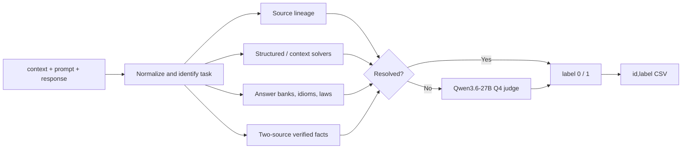

# Huntrix · Bengali LLM Hallucination Detection

Evidence-first, reproducible inference for the [অলীকবচন Bengali LLM Hallucination Detection Challenge](https://www.kaggle.com/competitions/bengali-hallucination).

> **Phase 1 private rank: #1 · private macro-F1: 0.982 (v91)** · Phase 2 rank: #7/32 · official Phase 2 score: 0.90144 · runtime: 3 h 52 min on T4×2

Team Huntrix consists of Touhidul Alam Seyam, MD. Abtahee Kabir, Joyeta Barua
Moni, and Noore Tamanna Orny.

## Result

The system improved from a `0.657` baseline to `0.966` with frozen v85 and then
to `0.967` with the five-change v91 typed-relation candidate. The breakthrough
was a change in architecture: deterministic source lineage, task-specific
solvers, and trusted evidence resolve high-confidence rows; a quantized
open-weight LLM judges only the uncertain tail.

The public organizer-compliance notebook now reproduces v91 directly from raw
input. The older v85 notebook remains frozen and unchanged as an independent
fallback artifact.

| Artifact | Frozen value |
|---|---|
| Best scored version | v91 |
| Final private leaderboard | **Rank #1 · macro-F1 0.982** |
| Final public leaderboard | **Rank #5 · macro-F1 0.967** |
| Frozen compliance version | v91 · public macro-F1 0.967 |
| Phase 1 rows | 2,516 |
| Output counts | label 0: 1,181 · label 1: 1,335 |
| Output SHA-256 | `0fec5d610f4e7b94ab6c46e2094d58e940b0f36781e9fa98d5466d2135474c28` |
| Released-label evaluation | macro-F1 0.993264 · label-0 F1 0.992701 · accuracy 0.993311 |
| Deterministic validation coverage | 225/299 at 1.000 macro-F1 |
| Compliance hardware | Kaggle Tesla T4 ×2 · internet disabled |
| Compliance runtimes | 440.87–593.43s across three full 2,516-row runs |
| Actual Phase 2 run | 5,000 rows · 13,921.91s (3 h 52 min 1.91s) |
| Phase 2 routing | 207 deterministic (4.14%) · 4,793 judged (95.86%) |
| Official Phase 2 result | **Rank #7 of 32 · score 0.90144** |

Three public Kaggle notebook runs produced CSVs that were byte-identical to
each other and to scored submission `54836339`.

## Method



The deterministic router handles:

- exact released BenHallu and public-QA lineage;
- arithmetic, numeric ranges, MCQs, Bengali morphology, compounds, and prefixes;
- intrinsic context support and contradiction;
- reliability-weighted answer banks;
- exact idiom and antonym evidence;
- authoritative Bangladesh-law sections;
- free-form facts recorded only after two-source verification.

The unresolved queue is sorted by row ID and processed in fixed batches. Context rows use one context-NLI view. No-context rows use fact, strict-exam, and zero-bias views with unanimous-positive voting and early exit after the first zero. Qwen3.6-27B Q4_K_P runs through pinned llama.cpp b9637 with a one-token binary grammar.

## Reproduce the frozen inference

The organizer-mandated input path is literal and must not be changed:

```python
from pathlib import Path

TEST_PATH = Path(
    "/kaggle/input/competitions/bengali-hallucination/test set.csv"
)
```

The submission notebook is:

```text
kaggle_notebooks/phase2_v91_inference/phase2_v91_inference.ipynb
```

Its Kaggle settings require:

- accelerator: `Tesla T4 x2`;
- internet: disabled;
- model: public `snowrab/qwen3-6-27b-q4-k-p/pyTorch/default/1`;
- public runtime/knowledge dataset:
  `seyamalam/bengali-hallucination-phase2-runtime-v91`;
- public pinned llama.cpp CUDA b9637 dataset;
- competition input mounted at the exact path above.

Push or inspect the notebook with:

```bash
.venv/bin/python -m kaggle kernels push \
  -p kaggle_notebooks/phase2_v91_inference

.venv/bin/python -m kaggle kernels status \
  seyamalam/bengali-hallucination-v91-compliance-inference
```

The notebook does **not** load a saved Phase 1 prediction vector. It derives predictions from raw rows and pinned inference assets.

## Repository map

```text
.
├── kaggle_notebooks/
│   ├── phase2_v85_inference/   # frozen, compliant raw-input notebook
│   ├── phase2_v91_inference/   # public scored-v91 compliance notebook
│   ├── phase2_t4_smoke/        # target-GPU smoke test
│   └── llama_cpp_cuda_builder/ # pinned runtime builder
├── kaggle_datasets/            # Kaggle asset metadata
├── scripts/                    # routing, evidence, audit, training, packaging
├── resources/                  # small verified and legal evidence records
├── tests/                      # regression and compliance tests
├── docs/
│   ├── JOURNEY.md              # complete narrative with charts and failures
│   ├── COMMIT_HISTORY.md       # every commit in chronological order
│   ├── DATA_SOURCES.md         # external data, links, licenses, and roles
│   └── paper/                  # rendered technical report
├── EXPERIMENT.log              # exact commands, scores, runtimes, artifacts
├── DECISION.log                # modeling and evidence-policy decisions
└── Problem.md                  # competition statement and constraints
```

Generated corpora, traces, models, and submissions live under `outputs/` and are intentionally ignored by Git. The repository tracks the code and compact evidence required to rebuild or audit them.

### Post-freeze Phase 2 development

The frozen v85 notebook remains unchanged. The development router now supports
an optional typed-evidence layer:

```bash
--typed-evidence resources/typed_evidence_v1.json
```

Unlike the legacy flat verified-fact bank, typed evidence records the requested
intent, explicit accepted answers, explicit rejected answers, context
conditions, and at least two source URLs. This prevents literal idiom meanings
from being accepted as figurative meanings and provides a schema for separating
writing, serialization, publication, birth, death, construction, and river
relations.

The optional corpus-backed idiom sense layer extends that distinction to the
10,359-record Bangla Bagdhara corpus:

```bash
--idiom-dataset \
  outputs/source_cache/bangla_bagdhara_lrec/bagdhara_export_done_2026-03-01_010356.json
```

It prefers exact dictionary headwords over aliases, retains duplicate records,
and abstains unless every applicable record supports the same literal-versus-
figurative decision. On 30,825 clean exact-headword controlled examples it
decides 15,977 at `100%` precision. The option is post-freeze Phase 2
development; omitting it preserves the frozen v85 output byte-for-byte.

The router also has a relation-guarded exact-context stage for textual answers.
It requires the answer to appear inside one semicolon-aware clause with at least
two nontrivial prompt anchors. Numeric and date questions are deliberately left
to the specialized relation parsers, preventing a copied birth, death,
discovery, or establishment year from being attached to the wrong question.

The numeric parser now binds exact ranges and single-value contradictions to a
relation-aligned clause. It handles Bengali compound number words up to 9,999,
splits numeric conjunctions, and rejects superlative or relation-swapped
evidence. The expanded rules are `19/19` on released controls and reduce the
post-freeze unresolved tail to 158 without changing the v89 candidate labels.

## Documentation

- [System bottleneck analysis](docs/BOTTLENECK.md)

- [Full project journey](docs/JOURNEY.md) — score progression, failed approaches, version ledger, lessons, and deployment history.
- [Four-page technical report](output/pdf/Huntrix_Technical_Report.pdf) — competition-ready PDF with architecture and results.
- [LaTeX paper source](docs/latex/Huntrix_Technical_Report.tex), [four-page PDF](output/pdf/Huntrix_Technical_Report.pdf), and [Markdown companion](docs/TECHNICAL_PAPER.md).
- [Final presentation](output/presentation/Huntrix_Final_Presentation_20_Slides.pptx) — light-themed scientific deck with a 15-slide timed talk and five technical appendix slides for Q&A; detailed methodology diagrams and presenter notes are embedded throughout. A [PDF copy](output/presentation/Huntrix_Final_Presentation_20_Slides.pdf) is included for review.
- [Presentation script](docs/HUNTRIX_PRESENTATION_SCRIPT.md) — four-speaker timing, handoffs, likely questions, and numbered source map; presenter-ready [DOCX](output/presentation/Huntrix_Presentation_Script.docx) and [PDF](output/presentation/Huntrix_Presentation_Script.pdf) editions are included.
- [Phase 2 runtime evidence](docs/PHASE2_RUNTIME_EVIDENCE.md) — organizer-run 5,000-row timing, routing distribution, and interpretation limits.
- [External data register](docs/DATA_SOURCES.md) — every non-competition source used, with links, licenses, and purpose.
- [Compliance review](docs/COMPLIANCE_REVIEW.md) — rule-by-rule audit and the organizer clarification.
- [Third-party notices](THIRD_PARTY_NOTICES.md) and [MIT license](LICENSE).
- [Complete commit chronology](docs/COMMIT_HISTORY.md).
- [Final submission freeze](docs/FINAL_SUBMISSION_FREEZE.md) — immutable notebook link, form values, and pinned Kaggle asset identifiers.
- [Raw experiment log](EXPERIMENT.log) and [decision log](DECISION.log).

## Data policy

The competition supplied only:

- `bengali-hallucination/dataset samples.json`;
- `bengali-hallucination/test set.csv`;
- `bengali-hallucination/sample submission.csv`.

All other corpora and answer sources were external. They were used with explicit roles—lineage audit, retrieval, controlled-pair generation, domain coverage, or deterministic evidence—and were not indiscriminately treated as hidden-label truth. See the [external data register](docs/DATA_SOURCES.md).

## What we learned

- The dataset mixes several task families; one global prompt or rule is structurally insufficient.
- The 299 labels are a validation and error-analysis set, not proof that a large fine-tune will generalize.
- More retrieval data can hurt when source trust and answer relation are ignored.
- Exact lineage, structured solvers, and corroborated evidence produced larger gains than prompt voting.
- Reproducibility—fixed order, pinned assets, constrained output, and hash verification—is part of the model.

The complete evidence for these conclusions is in [the journey](docs/JOURNEY.md).

## Phase 2 constraints

The final path is designed for:

- offline Kaggle execution;
- open-weight models only;
- `2×T4` GPU;
- fewer than 9 hours for approximately 5,000 rows;
- fewer than 50 GB of model weights;
- no paid APIs or hosted inference services.

The completed organizer-run Phase 2 notebook processed 5,000 rows in
13,921.91 seconds, or 3 hours 52 minutes 1.91 seconds. Deterministic coverage
fell from 93.72% in Phase 1 to 4.14% in Phase 2, so 4,793 rows reached Qwen.
The run still used only 42.97% of the nine-hour budget. See the
[Phase 2 runtime evidence](docs/PHASE2_RUNTIME_EVIDENCE.md) for measured stage
timings and routing counts. The organizers subsequently reported an official
Phase 2 score of `0.90144`, placing Huntrix seventh among 32 teams; row-level
labels were not released.

## Test and rebuild documentation

```bash
# Regression suite (after installing requirements.txt)
PYTHONPATH=scripts .venv/bin/python -m pytest -q

# Rebuild charts, commit appendix, and DOCX report
PYTHONPATH=/Users/seyam/.cache/codex-runtimes/codex-primary-runtime/dependencies/python \
  /Users/seyam/.cache/codex-runtimes/codex-primary-runtime/dependencies/python/bin/python3 \
  docs/scripts/build_project_docs.py
```

## Citation

If this repository is used in a report, cite the competition and the two benchmark-design references identified by the organizers:

- *BenHalluEval: A Multi-Task Hallucination Evaluation Framework for Large Language Models on Bengali*.
- *When Words Don’t Mean What They Say: Figurative Understanding in Bengali Idioms*, LREC 2026.
- Clark et al., *TyDi QA: A Benchmark for Information-Seeking Question Answering in Typologically Diverse Languages*, TACL 2020.

## Team

**Huntrix** · Touhidul Alam Seyam · IUT 12th ICT FEST Datathon, 2026
