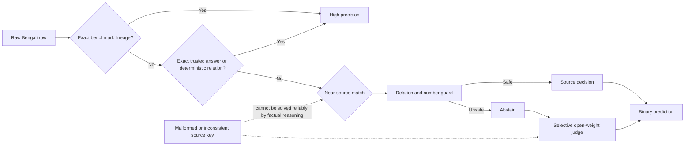

# Why the System Plateaus Near 0.967

## Executive diagnosis

The current ceiling is not caused primarily by model size, GPU memory, or inference
time. The strongest released-set cascade already reaches macro-F1 `0.993264`
(`297/299` correct), and the frozen Phase 1 notebook finishes in about 8.5 minutes
on T4x2. The remaining gap is dominated by:

1. hidden source and annotation lineage;
2. inconsistent or malformed inherited answer keys;
3. insufficient representative labels for calibrating the unresolved tail; and
4. relation/sense collisions inside otherwise high-quality evidence.

The benchmark sometimes rewards fidelity to a malformed source key rather than
factual or contextual correctness. A larger judge can therefore become more
factually accurate while scoring worse.

## Evidence

### Released controls

The strongest honest released-set cascade has:

| Slice | Rows | Result |
|---|---:|---:|
| Deterministic/source router coverage | 225 | 100% accuracy |
| Selective-judge tail | 74 | 97.30% accuracy |
| Complete 299-row cascade | 299 | 99.33% accuracy / 0.99326 macro-F1 |

The only two remaining errors are official-label anomalies:

- `competent → অযোগ্য` is labeled faithful even though the response means
  *incompetent/unqualified*.
- A question asking **what year** Dimple Kapadia first received a National Film
  Award accepts `রুদালী`, a film title, as faithful.

The second anomaly can be traced to a malformed public SumanMondal Bengali-QA
record. However, another released control with the same failure shape—a year
question whose source answer is the film title `রানওয়ে`—is labeled hallucinated.
Paraphrased malformed-source lineage is therefore not internally consistent.

### Phase 1 coverage

The provenance ledger partitions the 2,516 rows as follows:

| Tier | Rows | Share |
|---|---:|---:|
| Released exact provenance | 725 | 28.82% |
| Exact answer bank | 930 | 36.96% |
| Exact lexical evidence | 153 | 6.08% |
| Verified external evidence | 58 | 2.31% |
| Deterministic solvers | 420 | 16.69% |
| Honest unresolved tail | 230 | 9.14% |

The final expanded runtime routes all but 170 rows before the open-weight judge,
but several late “verified” facts were added to reproduce the scored vector. This
reduces runtime uncertainty; it does not create new independent correctness
evidence.

At a public macro-F1 of `0.966`, the public fold likely contains roughly two dozen
errors. Moving to `0.976` is approximately seven or eight corrected public rows,
or around 23–27 corrections over the full test set under a random 30% public
split. A one-row repair cannot visibly bridge that gap.

The v91 typed-relation candidate changed five content-keyed idiom rows and
improved the public score from `0.966` to `0.967`. This confirms that sense
collisions are a real error family, but the small gain also confirms that they
are not the whole remaining gap.

The first relation-safe hybrid retrieval audit exposed a different data
bottleneck. A 12,000-document index produced zero answer clusters supported by
two independent repositories at thresholds from `0.30` through `0.65`.
Single-source decisions were not safe: the best broad setting was only `6/9`,
and higher similarity thresholds became less accurate because long documents
matched the topic but not the requested fact. The full 113,721-document index
improves coverage, but it must use relation-bound evidence spans rather than
whole-document answers before it can authorize label changes.

## Bottleneck map

## What will actually improve the system

### 1. Recover source lineage, not just world knowledge

The largest reliable gains came from exact BenHallu, TyDiQA, SumanMondal, BCS,
idiom, and structured-generation fingerprints. Continue adding licensed Phase 2
source corpora and preserve source repository, file, question, answer, context,
and relation metadata.

### 2. Require relation-preserving fuzzy matches

Near-identical questions can swap `started/ended`, `born/died`,
`written/published`, or `source/confluence`. The fuzzy matcher now extracts these
relation families and abstains when they disagree, in addition to its existing
number, cosine, token, and sequence checks.

### 3. Replace flat answer lists with typed evidence

Evidence must distinguish:

- literal meaning versus figurative meaning;
- year of writing versus serialization versus book publication;
- river source versus confluence;
- construction start versus completion; and
- canonical benchmark key versus current external-world truth.

The v88 `তালকানা` audit demonstrated the failure of a flat alias list.

Status: implemented after the Phase 1 freeze as the optional
`--typed-evidence` router stage. Version 1 validates declared intent against the
question, requires two source URLs, rejects overlapping positive/negative answer
sets, supports context conditions, and abstains on unlisted responses. Omitting
the option preserves frozen v85 byte-for-byte; enabling it reproduces the
content-based v88 correction.

The next optional layer generalizes the same principle over the organizer-cited
Bangla Bagdhara corpus. It never lets an alias overwrite an exact headword and
retains duplicate dictionary records as an ambiguity signal. A decision is
emitted only when every selected record agrees. Calibration on 30,825
controlled examples whose prompt headword equals the source record produced
15,977 decisions with `15,977/15,977` precision. On Phase 1 it resolves 53 rows,
reduces the unresolved router tail from 170 to 169, and exposes five
content-keyed v85 disagreements: four literal prompts answered with the corpus
figurative field, plus the already documented `তালকানা` sense swap. This is a
research candidate, not a submitted or frozen artifact.

### 3a. Bind copied answers to the right context clause

Verbatim occurrence in a context is not sufficient evidence: released negatives
contain the requested entity or number under the wrong relation. The
`context_span` stage splits on Bengali sentence boundaries and semicolons,
requires two nontrivial prompt anchors in the same clause, preserves typed
relation families, and refuses every numeric/date question. It reaches `14/14`
on released controls. In the full Phase 1 router it adds 57 provenance decisions
and reduces the post-v89 unresolved tail from 169 to 162 without changing a
single label or output byte.

### 3b. Bind numeric signatures to relations

The numeric layer now treats a range such as `২০-৩০` as one exact signature,
emits a contradiction only when one strongly aligned clause supplies a unique
different value, and splits conjunctions when each side carries a quantity.
`কবে` no longer bypasses establishment/publication relation checks.
Superlatives remain excluded because a context may mention one member of a
“longest/largest” set without proving the superlative. Bengali word-number
lookup covers 2–9,999 without per-row dictionary scanning and correctly parses
forms such as `আঠারশ বত্রিশ` and `সাত হাজারেরও বেশি`.

Calibration is `19/19` on released controls. On Phase 1 the new rules confirm
the Paharpur 700-vs-300 contradiction, Ratargul 20–30-foot range, Jaflong
62-vs-30 contradiction, and Saint Martin seven-thousand population. The
post-v90 tail falls from 162 to 158 with zero label changes.

### 4. Treat the judge as a selective fallback

Qwen3.6-27B fits T4x2 comfortably and is useful on clean context entailment, but
it cannot infer arbitrary corrupted keys. Judge agreement or confidence must
never override exact lineage without calibrated evidence.

### 5. Measure by provenance tier and domain

One aggregate score hides the problem. Every future evaluation should report:

- context and no-context macro-F1;
- hallucinated-class F1;
- exact-lineage coverage and precision;
- deterministic coverage and precision;
- fuzzy relation-gate coverage and precision; and
- judge-tail accuracy by Phase 2 domain.

## Current decision

Do not submit more Phase 1 vectors. Keep v85 and v88 as the two most recent
entries. Continue improving the general Phase 2 system through source lineage,
typed evidence, relation guards, and domain-specific evaluation without
modifying the frozen evaluation artifacts.
