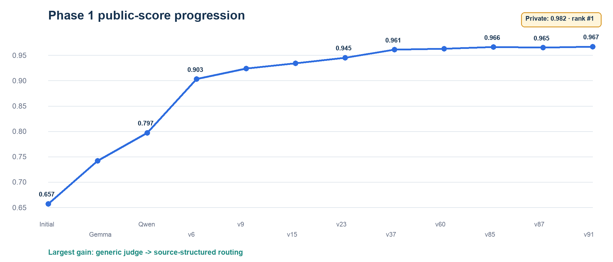
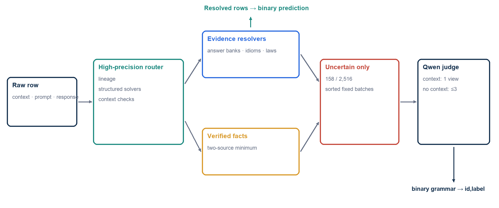
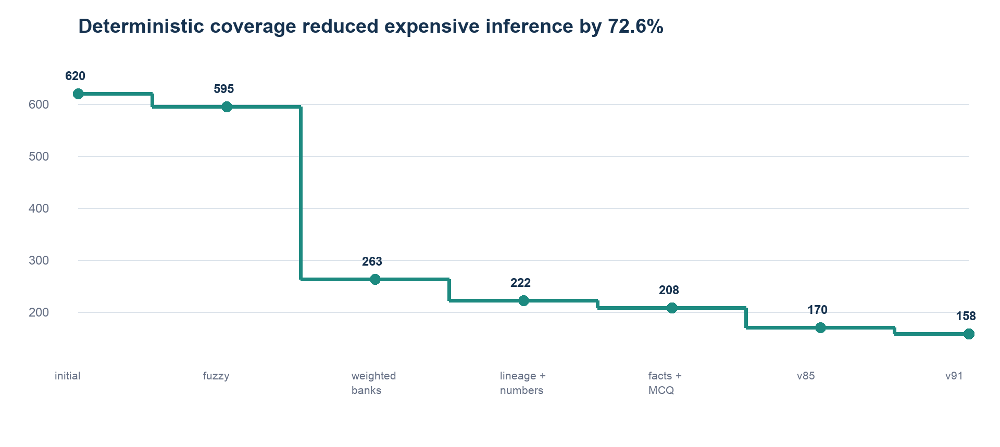

# From 0.657 to private 0.982: the Huntrix experiment journey

This is the narrative record of the অলীকবচন Bengali hallucination-detection project. It explains what we tried, what failed, why the architecture changed, how v85 established a reproducible `0.966` anchor, and how v91 finished at private macro-F1 `0.982` and rank `#1`. The raw, command-level record remains in [`EXPERIMENT.log`](../EXPERIMENT.log), policy decisions remain in [`DECISION.log`](../DECISION.log), and every repository commit is listed in [`COMMIT_HISTORY.md`](COMMIT_HISTORY.md).

## Outcome

| Result | Value |
|---|---:|
| Initial public macro-F1 | 0.657 |
| Best public macro-F1 | **0.967** |
| Final private macro-F1 / rank | **0.982 / #1** |
| Public absolute improvement | **+0.310** |
| Released-label macro-F1 | 0.993264 |
| Released-label hallucinated-class F1 | 0.992701 |
| Deterministic coverage on released labels | 225/299 at 1.000 macro-F1 |
| Frozen Phase 1 output | 2,516 rows; SHA-256 `0fec5d…74c28` |
| Byte-identical Kaggle compliance runs | 2 |
| T4×2 compliance runtime | 527.03–593.43 seconds |

The decisive insight was that this was not one homogeneous binary-classification problem. It was a mixture of context grounding, Bengali exam questions, arithmetic, grammar, idioms, laws, cultural facts, and generated source lineages. Treating every row as a generic LLM-judging prompt left a large accuracy gap. Routing each family to the strongest appropriate evidence source closed most of it.

## The six eras

### 1. Baselines: useful floor, weak factual grounding

The first char-, embedding-, and shallow-classifier submissions scored roughly `0.657–0.663`. They detected surface regularities but could not determine whether a Bengali cultural fact, historical date, or answer entity was actually correct. These runs established the evaluation plumbing and label orientation, but not a competitive model.

### 2. Generic LLM judges: progress, then a ceiling

Gemma 12B QAT raised the public score to `0.742`. A Qwen3.6-27B 4-bit judge with lexical handling reached `0.797`. This proved that an open-weight model could reason about many rows within the future Kaggle limits.

The weakness was transfer. Prompt variants that looked excellent on the 299 released labels did not reliably generalize. One prompt-vote ensemble reached `0.8512` locally and only `0.783` publicly. The small labeled set was diagnostically valuable but too narrow to select arbitrary prompt ensembles.

**Decision:** retain the LLM as a selective reasoner, not the sole classifier.

### 3. Retrieval and compact verifiers: more data was not automatically better

We normalized 177,876 external Bengali QA/literature rows, 172,357 lexical rows, 9,053 Bangladesh-specific Wikidata facts, 18,106 controlled fact swaps, and 120,000 context-contrastive examples. These assets improved coverage and exposed useful source relationships.

Several seemingly sensible approaches failed:

| Experiment | Local result | Why it was not promoted |
|---|---:|---|
| Raw external-QA evidence injection | 0.7920 macro-F1 | semantically adjacent snippets were often non-authoritative |
| Lexical-only portable verifier | 0.7879 OOF | surface model lacked factual and contextual reasoning |
| External-QA portable verifier | 0.8227 OOF | improved, but remained below evidence-aware Qwen |
| Context-contrastive verifier | 0.8261 OOF | strong context slice; no-context facts remained weak |
| Global exact-support context rule | — | grammar contexts described tasks rather than containing answers |

**Decision:** evidence needs a trust hierarchy. Retrieval candidates may propose or corroborate a decision; they must not automatically become truth.

### 4. The architecture breakthrough: source + structured routing

The source-structured v6 candidate jumped to `0.903`. It recognized generated arithmetic families, Bengali grammar patterns, exact public-QA questions, idioms, and other repeated structures. Successive lineage and numeric refinements reached v9 `0.924`, v11c `0.928`, and v15 `0.934`.

This was the largest single change in the project. The system stopped asking a 27B model to rediscover deterministic answers for every row and instead reserved it for the genuinely ambiguous tail.

### 5. Forensic provenance: small, defensible gains

v23 scored `0.945`; v37 reached `0.961`; v60 reached `0.963`; v85 reached `0.966`. These improvements came from exact source lineage, conservative fuzzy matching, reliability-weighted answer banks, authoritative legal text, Bengali lexical alternatives, and facts verified from at least two independent sources.

The most important discipline was learning what **not** to change:

- v73–v78 contained externally plausible corrections that contradicted recovered benchmark lineage. They were quarantined rather than submitted.
- Approximate TyDiQA and source containment matches were rejected because generated hallucinations can contain a valid answer alias.
- A single answer-bank conflict could not overrule stronger sources.
- v87 applied two independently researched fact corrections and fell to `0.965`; v85 was immediately restored as the leaderboard-proven anchor.

This era made the pipeline conservative. A row changed only when its evidence relation was general, reproducible, and stronger than the current provenance.

### 6. v91 typed relations, deployment, and exact reproduction

v91 added a relation-typed idiom layer plus stricter context-span and numeric
relation guards. It changed only five evidence-backed rows from v85, improving
the public score from `0.966` to `0.967`; the final private board scored it
`0.982`, rank `#1`.

The final compliance notebook uses the organizer-mandated literal path, offline Kaggle inputs, fixed seeds, sorted rows, fixed batching, constrained binary generation, and a pinned Qwen/llama.cpp runtime. Two T4×2 reruns generated byte-identical CSV files matching scored v91:

- 2,516 sequential IDs and exact `id,label` schema;
- label counts `{0: 1181, 1: 1335}`;
- SHA-256 `0fec5d610f4e7b94ab6c46e2094d58e940b0f36781e9fa98d5466d2135474c28`;
- total runtimes `527.03s` and `593.43s`;
- same-mix 5,000-row projections `1047.36–1179.31s`;
- pessimistic all-uncertain stress bound approximately `5.2–5.5h`.

No saved prediction vector is loaded. The notebook derives the result from the raw competition CSV and pinned assets.

## Major scored version ledger

| Version | Public macro-F1 | Principal change | Disposition |
|---|---:|---|---|
| Initial | 0.657 | classical/embedding baseline | retired |
| Gemma | 0.742 | 12B QAT generic judge | retained as lesson |
| Qwen | 0.797 | 27B judge + lexical prompt | reasoning component |
| v6 | 0.903 | source and structured routing | architecture pivot |
| v9 | 0.924 | numeric/source repairs | promoted |
| v11c | 0.928 | conservative calibration | promoted |
| v15 | 0.934 | expanded lineage | promoted |
| v23 | 0.945 | provenance repair batch | promoted |
| v37 | 0.961 | released source-lineage audit | promoted |
| v39 | 0.961 | provenance improvement, no score change | retained |
| v53 | 0.961 | safer provenance, no score change | retained |
| v60 | 0.963 | forensic corrections | promoted |
| **v85** | **0.966** | two-source birth-date repair | reproducible anchor |
| v87 | 0.965 | two plausible fact repairs | reverted |
| v88 | 0.966 | literal-vs-figurative idiom repair | retained |
| **v91** | **0.967** | five typed-relation corrections | **final scored system** |

The scored improvement batches were directionally informative: v15→v23 `+0.011`, v23→v37 `+0.016`, and v53→v60 `+0.002`. Unchanged rounded scores could not reveal individual row truth because the public board covered only about 30% of the test set.

## How the final system works

1. Normalize Bengali text, digits, punctuation, MCQ options, and answer aliases.
2. Recover exact released lineage and high-confidence source fingerprints.
3. Apply structured solvers for arithmetic, ranges, morphology, compounds, prefixes, and inline MCQs.
4. Apply intrinsic context-grounding checks.
5. Resolve exact and reliability-weighted answer-bank evidence.
6. Resolve exact lexical/idiom evidence and authoritative legal sections.
7. Admit free-form verified facts only with two independent sources.
8. Send only unresolved rows to a fixed-order, binary open-weight judge.

Context rows receive one context-NLI view. No-context rows use fact, strict-exam, and zero-bias views; a faithful prediction requires unanimity, and evaluation stops after the first zero.

The router evolved from 620 uncertain Phase 1 rows to 158, a 74.5% reduction in expensive inference. This improved speed and reduced exposure to judge variance.

## What changed our mind

### Local validation is a guardrail, not a leaderboard oracle

We continue to report macro-F1, label-0 F1, label-1 F1, accuracy, and context/no-context slices. But a 299-row sample cannot prove hidden-distribution generalization. Public scores and independent provenance remained separate evidence signals.

### Cultural correctness is source-sensitive

An answer can be defensible in the outside world and still contradict the supplied context or recovered task lineage. Intrinsic grounding outranks external plausibility when context is present.

### More data helps only when its role is explicit

External datasets served four different roles: exact lineage, retrieval candidates, controlled-pair generation, and domain coverage. Treating every downloaded answer as ground truth was harmful. Source identity, license, and trust weight became first-class metadata.

### Reproducibility is part of the model

The winning artifact was not complete until the same raw-input notebook produced the same bytes twice on the target hardware. Fixed scheduling, pinned assets, exact paths, constrained output, and hash verification are model-quality features for a code competition.

## Final evaluation snapshot

| Metric | Full 299-row cascade | 225 deterministic rows |
|---|---:|---:|
| Macro-F1 | 0.993264 | 1.000000 |
| F1, hallucinated class (`0`) | 0.992701 | 1.000000 |
| F1, faithful class (`1`) | 0.993827 | 1.000000 |
| Accuracy | 0.993311 | 1.000000 |

Only two internally inconsistent released controls remain. They were not memorized.

## Compliance disclosure

The scored router includes short citation-backed answers researched from public
sources for unlabeled Phase 1 prompts. No hidden label was available or used.
Because Kaggle Foundational Rule 4(b) can be read to prohibit human prediction
of test records, the team disclosed this exact methodology to the organizers
and requested clarification. That question was still pending when the package
was prepared; it is recorded in the public submission rather than concealed.

## Lasting lessons

- Decompose heterogeneous evaluation data before increasing model size.
- Prefer exact provenance and deterministic solvers for high-confidence families.
- Require corroboration before external facts can flip a label.
- Quarantine plausible but lineage-unsafe experiments.
- Measure hallucinated-class F1 and context/no-context behavior, not only aggregate macro-F1.
- Freeze the raw-input notebook, dependencies, hashes, and runtime—not merely the final CSV.
