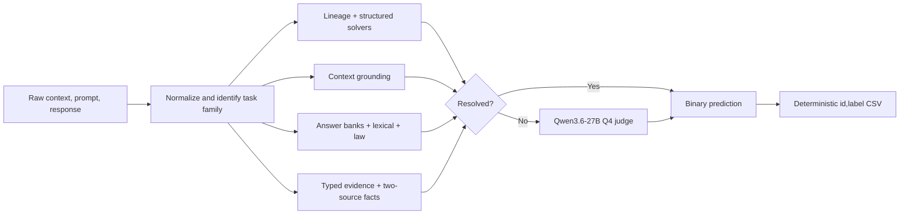

# Evidence-First Bengali Hallucination Detection

**A deterministic selective cascade for অলীকবচন · Team Huntrix**

This is the accessible source companion to the rendered ACL-style paper. The
main body occupies four pages and the references begin on page 5:

- [`latex/Huntrix_Technical_Report.tex`](latex/Huntrix_Technical_Report.tex)
- [`../output/pdf/Huntrix_Technical_Report.pdf`](../output/pdf/Huntrix_Technical_Report.pdf)

The PDF uses the official ACL class in final, non-anonymous mode on A4 paper,
with a native TikZ pipeline diagram and PGFPlots result charts. The exact
upstream style commit and file hashes are recorded in
[`latex/ACL_STYLE_SOURCE.md`](latex/ACL_STYLE_SOURCE.md). The older DOCX is
retained only as a historical draft.

## Abstract

We combine high-precision source lineage, structured task solvers, context-grounding checks, exact lexical and legal evidence, typed idiom reasoning, and a quantized open-weight judge used only for unresolved rows. The method raised Kaggle public macro-F1 from 0.657 to 0.967 and finished Phase 1 at private rank 1 with 0.982. On the 299 released labels, the final cascade reaches 0.9933 macro-F1 while deterministic stages cover 225 examples without error. Three frozen Kaggle T4x2 runs reproduced the scored v91 CSV byte for byte in 7.3--9.9 minutes.

## Architecture

The full method, experiment table, deployment protocol, compliance disclosure, limitations, and references are in the rendered report. The complete project narrative is in [`JOURNEY.md`](JOURNEY.md).
