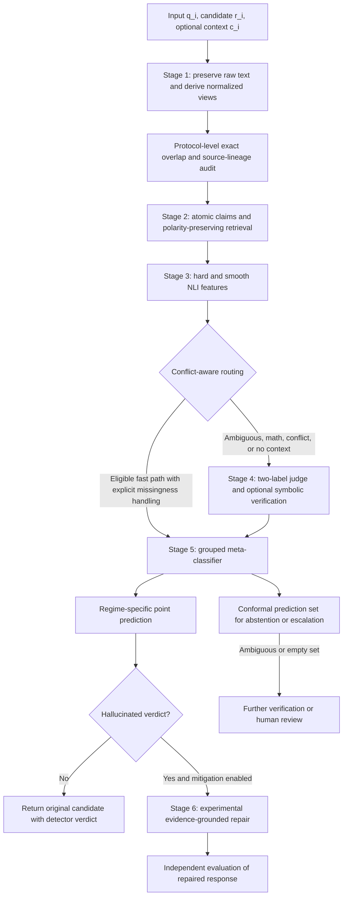

# BenHalluEval v2.0: Corrected Mathematical Formulation

## Status and intended use

This document corrects the mathematical notation and cross-document inconsistencies in:

- `benhallueval_v2_master_architecture.pdf`;
- the standalone technical-overview diagram;
- the six-stage flowchart;
- `01_Thesis/Docs/MASTER_ARCHITECTURE.md`; and
- `01_Thesis/Writing/chapters/04_methodology_master_architecture.md`.

It is a **corrected design specification**, not evidence that every component is implemented or empirically validated. The active detector in `01_Thesis/Code/Evaluation_Pipeline/update_evaluation.py` is a five-stage prototype and only partially implements this six-stage design. Stage 6 repair, split-conformal prediction, script-view Jensen–Shannon divergence, the symbolic sandbox, and several other elements are not currently implemented.

The thesis label convention is fixed throughout:

\[
y_i = 0 \iff \text{faithful/non-hallucinated},
\qquad
y_i = 1 \iff \text{hallucinated}.
\]

## Audit verdict

The PDF, overview diagram, and flowchart are **not fully mathematically consistent or correct**. The following changes are required:

1. Replace the probability-level CAD subtraction with a logit-level transformation followed by softmax; the displayed probability formula can produce negative values and need not sum to one.
2. Replace the claimed split-conformal threshold band with a valid conformal prediction set. Standard split conformal does not create an additive band around a classification threshold.
3. Correct the code-mixed first-token score used by the PDF implementation. Its denominator repeats the hallucination logit and therefore forces the code-mixed score to \(0.5\).
4. Replace the ambiguous early-exit Boolean expression with a parenthesized, conflict-aware routing rule.
5. Treat the first-token quantity as a **two-label normalized score**, not an automatically calibrated full-vocabulary probability.
6. Make BHS undefined when either track is absent; do not silently replace an absent track error rate with zero.
7. Use the full benchmark totals \(N_A=4{,}000\) and \(N_B=12{,}000\) only when reporting the complete supplied benchmark. For any subset, use its actual support rather than hard-coded counts. The PDF's \(1{,}000/4{,}000\) values describe at most the Bengali-QA task, not the full benchmark.
8. Keep positive-query and negated-query retrieval contributions distinguishable. Evidence retrieved for \(\neg c_k\) is potential counterevidence, not automatically support for \(c_k\).
9. Remove exact-match labeled-memory overrides from the independent pipeline, or report them as a separate lineage-assisted condition.
10. Describe hash matching as an overlap audit, not proof that source-lineage contamination has been eliminated.
11. Remove unsupported empirical statements—such as “Top 1%,” “publication-grade,” fixed performance gains, fixed latency reductions, and “eliminates” false alarms—until linked to validated experiments and citations.

---

## 1. Input, output, and task boundary

For candidate-answer detection, define

\[
x_i=(q_i,r_i,c_i),
\]

where \(q_i\) is the question or instruction, \(r_i\) is the existing candidate answer being evaluated, and \(c_i\in\mathcal C\cup\{\varnothing\}\) is optional grounding context.

The detector estimates

\[
\hat y_i=f_\theta(x_i)\in\{0,1\}.
\]

Detection and mitigation must be treated as distinct tasks:

- **Detection:** classify the original candidate \(r_i\).
- **Mitigation:** if \(\hat y_i=1\), optionally generate a revised answer \(r_i^*\).

A repaired answer must be evaluated as a newly generated output. It must not inherit the original candidate's gold label, and it must not be declared faithful solely because the same detector accepted its own repair.

---

## 2. BenHalluScore

Let

\[
A=\{i:y_i=0\},\qquad B=\{i:y_i=1\},
\]

with \(N_A=|A|>0\) and \(N_B=|B|>0\). Define

\[
\operatorname{FPR}_A
=
\frac{1}{N_A}\sum_{i\in A}\mathbf 1[\hat y_i=1],
\]

\[
\operatorname{FNR}_B
=
\frac{1}{N_B}\sum_{i\in B}\mathbf 1[\hat y_i=0].
\]

The general weighted BenHalluScore is

\[
\boxed{
\operatorname{BHS}_{w_A,w_B}
=
100\left(w_A\operatorname{FPR}_A+w_B\operatorname{FNR}_B\right)
}
\]

subject to

\[
w_A\ge 0,\qquad w_B\ge 0,\qquad w_A+w_B=1.
\]

The balanced default is

\[
\boxed{
\operatorname{BHS}
=
50\left(\operatorname{FPR}_A+\operatorname{FNR}_B\right)
}
\]

and is equivalent to

\[
\operatorname{BHS}
=
\frac{100}{2}
\left(
\frac{W_A}{N_A}+
\frac{W_B}{N_B}
\right),
\]

where \(W_A\) and \(W_B\) are wrong verdict counts on Tracks A and B. **Lower is better.** BHS is a weighted error percentage, not a probability and not a calibration measure in the strict statistical sense.

### 2.1 Operational failure-aware BHS

Let the recorded system outcome be

\[
\tilde y_i\in\{0,1,\bot\},
\]

where \(\bot\) denotes an inference or parsing failure. Under the active evaluator's operational policy,

\[
e_i^{(A)}=\mathbf 1[\tilde y_i\in\{1,\bot\}],\qquad i\in A,
\]

\[
e_i^{(B)}=\mathbf 1[\tilde y_i\in\{0,\bot\}],\qquad i\in B.
\]

Then

\[
\operatorname{BHS}_{\mathrm{op}}
=
100\left(
w_A\frac{\sum_{i\in A}e_i^{(A)}}{N_A}
+
w_B\frac{\sum_{i\in B}e_i^{(B)}}{N_B}
\right).
\]

A valid-only BHS may also be reported, but it must include valid coverage and must not be directly compared with operational BHS. If either track is absent, aggregate BHS is **undefined**; report the available track-specific rate instead.

---

## 3. Stage 1: raw-text-preserving dual-view normalization

### 3.1 Raw text and canonical keys

Never replace scientific inputs with normalized keys. Preserve

\[
S_i^{\mathrm{raw}}
\]

and derive separate normalized views

\[
S_i^{\mathrm{native}}=N_{\mathrm{bn}}(S_i^{\mathrm{raw}}),
\qquad
S_i^{\mathrm{code}}=N_{\mathrm{code}}(S_i^{\mathrm{raw}}).
\]

Unicode normalization and character substitutions are deterministic preprocessing operations, but they are not universally “lossless.” NFKC and zero-width-character deletion may remove distinctions; therefore the raw string must remain available.

A total selective transducer should include an identity fallback and explicit precedence:

\[
\Phi(w)=
\begin{cases}
w, & w\in \mathcal V_{\mathrm{English}}\cup\mathcal V_{\mathrm{technical}},\\
\operatorname{Translit}_{\mathrm{BN}}(w), & w\in\mathcal V_{\mathrm{RomanBangla}},\\
w, & \text{otherwise}.
\end{cases}
\]

If vocabularies overlap, the precedence shown above must be declared and tested.

### 3.2 Token fertility

For a fixed tokenizer \(\tau\), define

\[
\boxed{
F_\tau(S)=
\frac{|\operatorname{Tok}_\tau(S)|}{W(S)}
},
\qquad W(S)>0.
\]

The thesis must state:

- the tokenizer and revision;
- whether BOS/EOS and other special tokens are excluded;
- the Bengali/code-mixed word-counting rule; and
- how empty input is handled.

Token fertility is a descriptive measurement. Normalization alone does not prove that fertility has been “controlled” or reduced. A reduction such as \(3.42\to1.28\) requires a recorded tokenizer experiment or vocabulary modification and may not be claimed from this formula alone.

### 3.3 Thirteen-token overlap audit

For token sequence \((t_1,\ldots,t_n)\), define

\[
H_{13}(S)=
\begin{cases}
\left\{
\operatorname{SHA256}\!\left(
\operatorname{encode}(t_i\Vert\cdots\Vert t_{i+12})
\right):1\le i\le n-12
\right\}, & n\ge13,\\
\varnothing, & n<13.
\end{cases}
\]

The canonicalization, tokenizer, separator, encoding, and hash representation must be fixed in the experiment protocol. An overlap indicator may be defined as

\[
I_{13}(x_i)
=
\mathbf 1\!\left[
H_{13}(N(q_i\Vert r_i\Vert c_i))
\cap \mathcal G_{\mathrm{train}}
\ne\varnothing
\right].
\]

This detects exact canonical 13-token overlap only. It is neither proof of contamination when positive nor proof of source independence when negative. Source documents, derivative questions, answer-generation lineage, entities, and near-duplicate semantics require a separate provenance audit.

---

## 4. Stage 2: regime-aware contrastive retrieval

### 4.1 Evidence pool

Use supplied context directly for open-book rows:

\[
\mathcal D_i=
\begin{cases}
\operatorname{Segment}(c_i), & c_i\ne\varnothing,\\
\mathcal D_{\mathrm{external}}^{\mathrm{approved}}, & c_i=\varnothing.
\end{cases}
\]

The external corpus must be licensed, provenance-recorded, and source-disjoint from evaluation material for an independent experiment. Exact hash filtering is only one overlap check.

### 4.2 Atomic claims

Let

\[
\operatorname{Claims}(r_i)=\{c_{i1},\ldots,c_{iK_i}\}.
\]

A cap such as \(K_i\le4\) is an implementation budget, not a mathematical property. The claim-selection and truncation policy must be recorded because truncation can omit the hallucinated claim.

For each claim, define

\[
q_{ik}^{+}=Q(q_i,c_{ik}),
\qquad
q_{ik}^{-}=Q(q_i,\neg c_{ik}).
\]

Natural-language negation is not always logically exhaustive; generation failures and ambiguous negations must be retained as explicit status, not treated as valid counterclaims.

### 4.3 Polarity-preserving RRF

Let \(\mathcal M\) be the set of retrievers, \(L_{m,q}\) the ranked list returned by retriever \(m\) for query \(q\), and \(\kappa=60\). For polarity \(s\in\{+,-\}\), define

\[
\boxed{
\operatorname{RRF}^{s}(d\mid c_{ik})
=
\sum_{m\in\mathcal M}
\frac{
\mathbf 1[d\in L_{m,q_{ik}^{s}}]
}{
\kappa+\operatorname{rank}_{m,q_{ik}^{s}}(d)
}
}.
\]

If a single candidate pool is needed, ranking may use

\[
\operatorname{RRF}^{\mathrm{pool}}(d\mid c_{ik})
=
\operatorname{RRF}^{+}(d\mid c_{ik})
+
\operatorname{RRF}^{-}(d\mid c_{ik}),
\]

but the two component scores and query polarity must remain attached to the evidence. A document retrieved by \(q^-\) is potential counterevidence and must not be interpreted as support merely because its fused score is high.

---

## 5. Stage 3: per-claim NLI and conflict-aware routing

For evidence sentences \(e_{ikj}\), define

\[
p_{ik}^{\mathrm{ent}}
=
\max_j P_{\mathrm{NLI}}
(\mathrm{entail}\mid e_{ikj},c_{ik}),
\]

\[
p_{ik}^{\mathrm{con}}
=
\max_j P_{\mathrm{NLI}}
(\mathrm{contradict}\mid e_{ikj},c_{ik}).
\]

These scores may come from different evidence sentences. They are model scores, not guaranteed truth probabilities, and they need not be complementary.

### 5.1 Smooth extrema

For \(\tau>0\), \(w_{ik}\ge0\), and \(\sum_k w_{ik}=1\), define

\[
\boxed{
\operatorname{SMin}_{\tau}^{\mathrm{ent}}(r_i)
=
-\tau\log
\sum_{k=1}^{K_i}
w_{ik}\exp\!\left(-\frac{p_{ik}^{\mathrm{ent}}}{\tau}\right)
}
\]

and

\[
\boxed{
\operatorname{SMax}_{\tau}^{\mathrm{con}}(r_i)
=
\tau\log
\sum_{k=1}^{K_i}
w_{ik}\exp\!\left(\frac{p_{ik}^{\mathrm{con}}}{\tau}\right)
}.
\]

Use a numerically stable log-sum-exp implementation. With normalized weights, smooth-min lies at or above the hard minimum and smooth-max lies at or below the hard maximum. Smoothing can therefore hide an isolated weak or contradicted claim. Retain and report the hard extrema as separate features:

\[
E_{\min}=\min_k p_{ik}^{\mathrm{ent}},
\qquad
C_{\max}=\max_k p_{ik}^{\mathrm{con}}.
\]

The smooth operators do not, by themselves, “eliminate” false alarms.

### 5.2 Correct early-routing rule

A single OR expression does not identify which verdict should be emitted and can mishandle conflicting high entailment and contradiction. Define a tri-state route instead. Let \(\gamma_E\) be a high-entailment threshold, \(\gamma_C\) a high-contradiction threshold, and \(\lambda_C\) a low-contradiction ceiling:

\[
R_i=
\begin{cases}
\text{fast-faithful},
& c_i\ne\varnothing\land\neg\operatorname{isMath}(x_i)
\land S_{\mathrm{ent}}\ge\gamma_E
\land C_{\max}\le\lambda_C,\\
\text{fast-hallucinated},
& c_i\ne\varnothing\land\neg\operatorname{isMath}(x_i)
\land S_{\mathrm{con}}\ge\gamma_C
\land E_{\min}<\gamma_E,\\
\text{full-verification}, & \text{otherwise},
\end{cases}
\]

where

\[
S_{\mathrm{ent}}=\operatorname{SMin}_{\tau}^{\mathrm{ent}},
\qquad
S_{\mathrm{con}}=\operatorname{SMax}_{\tau}^{\mathrm{con}}.
\]

If both confident conditions hold, route to full verification rather than choosing an arbitrary verdict. Any latency or error-rate gain must be measured. If Stage 4 is skipped, the meta-classifier must be trained with explicit missingness indicators or a separate fast-path classifier; silently substituting zero-valued Stage-4 features is not valid.

### 5.3 QA/QG proxies

For generated QA pairs \(\mathcal P(r_i)\), a semantic precision proxy is

\[
\operatorname{PrecProxy}(D,r_i)
=
\frac{1}{|\mathcal P(r_i)|}
\sum_{(q,a)\in\mathcal P(r_i)}
\operatorname{BERTScoreR}
\left(\operatorname{QA}(D,q),a\right),
\]

provided \(|\mathcal P(r_i)|>0\). Otherwise the value is undefined and should be accompanied by a generation-failure indicator. BERTScore recall is a semantic-similarity proxy, not formal entailment or statistical precision.

A weighted answerability proxy can be written as

\[
\operatorname{RecProxy}(D,r_i)
=
\frac{
\sum_{(q,a)\in\mathcal P(D)}W(q,D)\operatorname{Ans}(r_i,q)
}{
\sum_{(q,a)\in\mathcal P(D)}W(q,D)
},
\]

when the denominator is positive. If answerable and unanswerable alternatives are comparable outputs from one decision head,

\[
\operatorname{Ans}(r_i,q)
=
\frac{
\exp \ell_{\mathrm{answerable}}(r_i,q)
}{
\exp \ell_{\mathrm{answerable}}(r_i,q)
+
\exp \ell_{\mathrm{unanswerable}}(r_i,q)
}.
\]

A multi-token answer sequence log-likelihood must not be compared directly with a single unanswerable-token logit unless the model and normalization make them comparable.

---

## 6. Stage 4: first-token judge, script disagreement, and symbolic execution

### 6.1 Two-label normalized first-token score

Let \(L_h(S)\) and \(L_f(S)\) be first-step logits for distinct, validated single-token labels representing hallucinated and faithful. Define

\[
\boxed{
s_h^{(2)}(S)
=
\frac{\exp L_h(S)}{
\exp L_h(S)+\exp L_f(S)
}
=
\sigma\!\left(L_h(S)-L_f(S)\right)
}.
\]

Compute this with a stable log-softmax or sigmoid of the logit difference. The associated margin is

\[
m^{(2)}(S)=|2s_h^{(2)}(S)-1|.
\]

This is a score normalized over two selected labels. It is not the model's full-vocabulary probability and is not automatically calibrated. If labels are multi-token, use complete sequence log-likelihoods or redesign the output vocabulary; do not use only the first subtoken.

The PDF implementation must change the code-mixed calculation from a repeated hallucination term to

```python
p_cm = exp(lh_cm - z_cm) / (
    exp(lh_cm - z_cm) + exp(lf_cm - z_cm)
)
```

where `z_cm = max(lh_cm, lf_cm)`.

### 6.2 Cross-view Jensen–Shannon divergence

Define

\[
P_i=
\left[
s_h^{(2)}(S_i^{\mathrm{native}}),
1-s_h^{(2)}(S_i^{\mathrm{native}})
\right],
\]

\[
Q_i=
\left[
s_h^{(2)}(S_i^{\mathrm{code}}),
1-s_h^{(2)}(S_i^{\mathrm{code}})
\right],
\qquad
M_i=\frac{P_i+Q_i}{2}.
\]

Then

\[
\boxed{
D_{\mathrm{script}}(x_i)
=
\frac12D_{\mathrm{KL}}(P_i\|M_i)
+
\frac12D_{\mathrm{KL}}(Q_i\|M_i)
}.
\]

With natural logarithms,

\[
0\le D_{\mathrm{script}}\le\log 2.
\]

JSD measures disagreement between views, not hallucination. Transliteration errors, semantic changes, label-token instability, and genuine code-mixing effects can all increase it.

### 6.3 Symbolic execution result

For supported mathematical tasks, define an explicit result state

\[
z_i^{\mathrm{exec}}
\in
\{
\mathrm{verified},
\mathrm{contradicted},
\mathrm{unresolved},
\mathrm{timeout},
\mathrm{exception}
\}.
\]

Timeouts, exceptions, parser failures, and unsupported problems must not default to faithful. Candidate-text matching is not symbolic verification. The sandbox protocol must specify allowed operations, resource limits, timeout, deterministic seeds where relevant, and the mapping from execution results to detector features. A sandbox is a security and engineering component; its correctness cannot be established by an equation alone.

---

## 7. Stage 5: meta-classification, thresholding, and conformal abstention

### 7.1 Out-of-fold lexical compression

Let \(v_i^{\mathrm{lex}}\) be the character TF-IDF vector. For each training row \(i\), obtain a prediction only from a model trained without that row's source group:

\[
\boxed{
z_i^{\mathrm{lex,OOF}}
=
P_{g(i)}
\left(Y=1\mid v_i^{\mathrm{lex}}\right)
},
\]

where \(g(i)\) indexes the held-out grouped fold. For a new evaluation row, use an aggregation of models fitted on eligible source-disjoint training data:

\[
z_*^{\mathrm{lex}}
=
\frac{1}{F}
\sum_{f=1}^{F}
P_f(Y=1\mid v_*^{\mathrm{lex}}).
\]

A logistic output is a risk score unless held-out calibration has been demonstrated. If the design uses 16 NLI features, 4 judge/JSD features, 10 surface features, and one lexical score, the resulting vector is indeed

\[
v_i\in\mathbb R^{31}.
\]

This 31-dimensional design must not be described as the current implementation without verifying the actual feature manifest.

### 7.2 Source-grouped training

All folds must group source questions/documents and known generated derivatives—not merely normalized row IDs. For model family \(m\), fold \(f\), and seed \(s\), write

\[
p_{s,f,m}(x_i)=P_{s,f,m}(Y=1\mid v_i).
\]

An ensemble score may be

\[
\bar p_i
=
\frac{1}{|\mathcal E|}
\sum_{(s,f,m)\in\mathcal E}
p_{s,f,m}(x_i),
\]

provided every member is trained without the evaluation row or its source lineage. Seeds, folds, regularization values, model selection, and aggregation must match the actual implementation and run manifest.

### 7.3 Regime-specific BHS threshold selection

Let \(r_i\in\{\mathrm{open},\mathrm{closed}\}\), and define

\[
\hat y_i(\theta_o,\theta_c)
=
\begin{cases}
\mathbf 1[\bar p_i\ge\theta_o], & r_i=\mathrm{open},\\
\mathbf 1[\bar p_i\ge\theta_c], & r_i=\mathrm{closed}.
\end{cases}
\]

Select thresholds jointly on a source-disjoint development/calibration set:

\[
\boxed{
(\theta_o^*,\theta_c^*)
\in
\arg\min_{(\theta_o,\theta_c)\in\Theta^2}
\widehat{\operatorname{BHS}}_{\mathrm{dev}}
(\theta_o,\theta_c)
}.
\]

The protocol must define:

- grid endpoints and spacing or candidate thresholds;
- the inclusive comparison \(\ge\);
- deterministic tie-breaking;
- behavior when a regime or fold lacks either track;
- whether threshold model selection is nested inside an outer performance-estimation loop; and
- confirmation that evaluation labels were never used.

Maximizing the sum of regime-specific F1 scores is not equivalent to minimizing overall BHS. The architecture and thesis must choose and report one pre-registered objective.

### 7.4 Correct split-conformal prediction

A conformal prediction set is separate from the point-prediction threshold. Let a proper training set fit \(\hat p_y(x)\), and let a separate exchangeable calibration set contain \((x_i,y_i)_{i=1}^{n}\). Define nonconformity scores

\[
a_i=1-\hat p_{y_i}(x_i).
\]

For target miscoverage \(\alpha\), define the finite-sample quantile

\[
\hat q_{1-\alpha}
=
\operatorname{Quantile}_{\lceil(n+1)(1-\alpha)\rceil/n}
(a_1,\ldots,a_n).
\]

The prediction set is

\[
\boxed{
\Gamma_\alpha(x)
=
\left\{
y\in\{0,1\}:
1-\hat p_y(x)\le\hat q_{1-\alpha}
\right\}
}.
\]

Interpret it as follows:

- \(\Gamma_\alpha(x)=\{0\}\): singleton faithful prediction;
- \(\Gamma_\alpha(x)=\{1\}\): singleton hallucinated prediction;
- \(\Gamma_\alpha(x)=\{0,1\}\): ambiguous; route to further verification or human review;
- \(\Gamma_\alpha(x)=\varnothing\): explicit failure/out-of-distribution handling.

For regime-specific marginal coverage, calibrate separate \(\hat q_r\) values only if each regime has adequate calibration support and the split is pre-specified. Standard split conformal provides marginal coverage under exchangeability. It does **not** guarantee \(\mathrm{BHS}\le\alpha\), class-conditional coverage, or an additive interval

\[
[\theta_r^*-\delta_\alpha,\theta_r^*+\delta_\alpha].
\]

That threshold-band statement must be removed from the PDF and diagrams unless a separate risk-control method and theorem are supplied.

### 7.5 Exact-match label memory

For the primary independent experiment, do not copy labels from benchmark-derived answer memory. An override of the form

\[
k(x_{\mathrm{test}})=k(x_{\mathrm{train}})
\Longrightarrow
\hat y_{\mathrm{test}}=y_{\mathrm{train}}
\]

is lineage-assisted if the memory contains benchmark gold answers, generated hallucinations, saved labels, source-overlapping derivatives, or target-specific facts.

If a separately sourced, license-approved, source-disjoint memory is studied, treat it as a separate disclosed condition. Require exact provenance, collision checks, conflict abstention, raw-key preservation, and separate override coverage/error reporting. A Jaccard threshold of \(0.98\) is a near match, not an exact match.

---

## 8. Stage 6: contradicted-claim isolation and experimental mitigation

Define contradicted claims as a heuristic set

\[
\mathcal C_i^{\mathrm{bad}}
=
\{c_{ik}:p_{ik}^{\mathrm{con}}>\tau_{\mathrm{con}}\}.
\]

The threshold \(\tau_{\mathrm{con}}\) must be selected on development data and does not prove logical contradiction. Missing or weak evidence should yield uncertainty rather than automatic repair.

### 8.1 Correct context-contrastive decoding

The probability-level equation displayed in the diagrams,

\[
(1+\alpha)P(y_t\mid x,c)-\alpha P(y_t\mid x),
\]

is invalid as a probability distribution because entries can be negative and the result is not guaranteed to be normalized.

Use aligned logits from the same model, vocabulary, prompt template, and decoding step:

\[
\boxed{
\ell_{\mathrm{CAD}}(y_t)
=
(1+\alpha)\ell(y_t\mid q_i,c_i,r_{i,<t}^*)
-
\alpha\ell(y_t\mid q_i,r_{i,<t}^*)
},
\qquad \alpha\ge0.
\]

Then define a valid next-token distribution:

\[
\boxed{
P_{\mathrm{CAD}}(y_t)
=
\operatorname{softmax}
\left(\ell_{\mathrm{CAD}}/T\right)_{y_t}
},
\qquad T>0.
\]

CAD is an experimental decoding transformation. It does not guarantee factuality and is not, by itself, surgical span repair. A repair system must also specify:

1. how contradicted spans are aligned to output text;
2. which spans may change;
3. how unaffected content is preserved;
4. how evidence is cited or traced;
5. what happens when evidence conflicts or is absent; and
6. how repaired outputs are evaluated independently.

Suggested mitigation reporting includes repair success, residual hallucination rate, new-error rate, semantic-preservation score, abstention/failure coverage, and human review. Do not merge these results into the original detector BHS without a pre-specified protocol.

---

## 9. Corrected six-stage flow



---

## 10. Cross-document replacement table

| Existing expression or claim | Verdict | Required replacement |
|---|---|---|
| \(F(S)=|T|/W\) | Correct with assumptions | Add tokenizer subscript, \(W>0\), and token/word-count policy. |
| NFKC/zero-width stripping is “lossless” | Incorrect | Preserve raw text and describe normalized text as a derived view. |
| Thirteen-gram hash “purges contamination” | Overstated | Call it an exact-overlap audit; add source-lineage/derivative checks. |
| RRF sums dense/sparse results without query polarity | Incomplete | Use \(\operatorname{RRF}^{+}\) and \(\operatorname{RRF}^{-}\), retaining polarity. |
| Smooth-min “eliminates FPR” | Unsupported | Present smooth/hard extrema as features and validate empirically. |
| Early exit: context AND non-math AND entailment OR contradiction | Ambiguous | Use a parenthesized tri-state, conflict-aware routing rule. |
| First-token “softmax logit probability” | Misnamed | Use “two-label normalized first-token score”; validate token encodings and calibration. |
| JSD formula | Correct | Fix code-mixed softmax implementation and describe JSD as disagreement. |
| PDF conformal threshold band | Invalid | Replace with \(\Gamma_\alpha(x)\), a conformal prediction set. |
| Diagram CAD probability subtraction | Invalid | Transform logits, then apply softmax. |
| Missing track contributes zero to BHS | Invalid | BHS is undefined when either track is absent. |
| Exact-match labeled memory is leak-free | Unsafe | Remove from independent evaluation or report separately as lineage-assisted. |
| Stage 6 always returns a repaired faithful answer | Unsupported | Permit abstention/failure and evaluate repairs independently. |
| Six-stage design aligns directly with active code | Incorrect | Mark stage/component implementation status explicitly. |

---

## 11. Implementation and evidence status

### Partially represented in the active prototype

- NFKC/Bengali canonicalization and a single normalized view;
- token-fertility measurement;
- claim extraction with a current maximum of three claims;
- E5 plus BM25 RRF and BGE reranking;
- QA/NLI/XLM-R-derived features;
- restricted first-token label scoring;
- grouped logistic-regression meta-classification;
- regime-specific threshold selection; and
- correct thesis-label BHS computation.

### Not implemented as shown in the v2 PDF/diagrams

- true dual native/code-mixed views;
- 13-token benchmark overlap audit;
- polarity-preserving contrastive retrieval;
- weighted smooth-min/smooth-max and the proposed early-exit route;
- script-view JSD;
- air-gapped SymPy execution and symbolic fallback;
- 4,000-to-1 out-of-fold lexical compression;
- valid split-conformal prediction sets;
- CAD-based generation; and
- active surgical span repair.

### Claims requiring experiments or citations before thesis use

Do not state the following as findings until each is linked to a recorded experiment, dataset hash, implementation version, support counts, failure policy, and citation where applicable:

- “Top 1%,” “definitive,” or “publication-grade”;
- 11.66–22.85 percentage-point script improvement;
- fertility reduction from 3.42 to 1.28;
- 8%–18% accuracy loss per fertility unit with \(p<0.006\);
- 1.51% contamination;
- 30% Track-A false alarms caused by hard minimum;
- approximately 75% latency reduction;
- 10%–35% Bengali parsing failures;
- 34.78% mathematical shortcut behavior;
- JSD improving hallucination detection;
- smooth-min eliminating false alarms;
- \(\alpha=0.05\) implying 5% BHS risk; or
- CAD guaranteeing factual repair.

## Recommended diagram labels

Use these exact short labels in a revised diagram:

- `0 = faithful; 1 = hallucinated`
- `BHS: weighted error %, lower is better`
- `Two-label normalized first-token score`
- `Cross-view disagreement (JSD)`
- `Smooth NLI pooling + retained hard extrema`
- `Conflict-aware fast-path routing`
- `Conformal prediction set / abstention`
- `CAD: experimental logit transformation`
- `Independent detection` versus `optional mitigation`
- `Exact-overlap audit; source-lineage audit still required`
- `Lineage-assisted memory ablation` if label memory is retained

## Project evidence used for this correction

- `docs/DATA_GUIDE.md`
- `docs/RESEARCH_REUSE.md`
- `01_Thesis/Docs/MASTER_ARCHITECTURE.md`
- `01_Thesis/Writing/chapters/04_methodology_master_architecture.md`
- `01_Thesis/Code/Evaluation_Pipeline/update_evaluation.py`
- `01_Thesis/Code/Evaluation_Pipeline/eval.py`
- `01_Thesis/Code/Evaluation_Pipeline/judge_parsing.py`
- `01_Thesis/Code/Evaluation_Pipeline/test_pipeline.py`
- `benhallueval_v2_master_architecture.pdf`

The corrected formulas above should replace the corresponding PDF/diagram equations. They do not replace the need for citations, implementation tests, source-lineage audits, or empirical validation.
