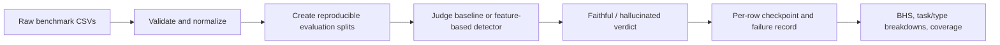

# Project Analysis: Bengali LLM Hallucination Thesis

## In one paragraph

This workspace supports a thesis about evaluating and detecting hallucinations in large language model (LLM) answers written in Bengali and code-mixed Bengali. Its main benchmark, BenHalluEval, combines Bengali question answering, code-mixed question answering, summarization, and mathematics/reasoning examples. The active thesis code prepares consistent data, asks language models or a multi-signal detector whether each candidate answer is faithful, and measures the errors. The workspace also preserves two earlier datathon systems as research references. Those systems are useful for ideas and comparison, but their data access, labels, and competition results must not be mistaken for independent thesis evidence.

Draft material uses the title “BenHalluEval: A Comprehensive Benchmark for Evaluating Hallucinations of Large Language Models on Low-Resource Bengali NLP Tasks.” The project files suggest two related research questions: how reliably can models identify hallucinated Bengali answers across different tasks, and how do detection errors vary across task types and dialects? The workspace does not yet contain a finalized research question or a completed thesis.

## What counts as a hallucination here?

The benchmark provides two tracks. Track A contains answers treated as faithful; Track B contains answers treated as hallucinated. The thesis uses:

| Track | Thesis label | Meaning |
|---|---:|---|
| Track A | `0` | Non-hallucinated / faithful |
| Track B | `1` | Hallucinated |

This convention matters because both preserved datathon references use the opposite labels (`0 = hallucinated`, `1 = faithful`). Any future use of a reference prediction must validate and translate its label explicitly.

Each normalized benchmark row has an ID, task, track, hallucination type, question, context, candidate answer, and ground-truth label. A model receives the question, candidate answer, and any relevant context; evaluation metadata such as track and gold label should only be used for scoring.

## Benchmark data

The supplied BenHalluEval files contain **16,000 rows**: 4,000 Track A examples and 12,000 Track B examples. The four task groups are:

| Task | Track A | Track B | What is evaluated |
|---|---:|---:|---|
| Bengali QA (`bn_qa`) | 1,000 | 4,000 | Answers to Bengali questions |
| Code-mixed QA (`codemixed_qa`) | 1,000 | 4,000 | Answers to Bengali/English mixed questions |
| Summarization | 1,000 | 3,000 | Summaries grounded in source text |
| Mathematics/reasoning (`math`) | 1,000 | 1,000 | Numeric or reasoning answers |

Track B uses 12 canonical error types, including factualness, comprehension, specificity, inference, fabricated content, contradiction, arithmetic slips, formula misuse, invalid deductions, and semantic drift. Track A is assigned type `None`. The source CSVs are preserved as raw inputs; normalized data is stored separately. Code-mixed examples use their code-mixed fields, and mathematical signs and raw Bengali should be preserved during normalization.

There is no real dialect dataset in the workspace. A dialect schema and mock fixtures exist for software checks, but synthetic dialect wording and scores are not human judgments or validated evidence. The planned dialect analysis therefore cannot support conclusions yet.

See [the thesis data guide](01_Thesis/Data/BenHalluEval/README.md) and [the canonical data and integration guide](docs/DATA_GUIDE.md) for field details, source counts, and limitations.

## How the evaluation works

The workspace contains two active ways to evaluate a detector:

1. **Judge baseline.** [`make_splits.py`](01_Thesis/Code/Evaluation_Pipeline/make_splits.py) validates and normalizes data, then writes deterministic evaluation subsets. [`eval.py`](01_Thesis/Code/Evaluation_Pipeline/eval.py) sends each row to a selected backend—local Ollama or Transformers, an OpenAI-compatible service, OpenRouter, or a mock judge. It parses the verdict, records response and failure details in resumable JSONL checkpoints, and writes reports.
2. **Feature-based detector.** [`update_evaluation.py`](01_Thesis/Code/Evaluation_Pipeline/update_evaluation.py) combines several signals: Bengali/Banglish normalization, claim generation and judge logits, dense and sparse retrieval, evidence reranking, QA/NLI/semantic features, lexical features, and a logistic-regression meta-classifier. Training examples whose normalized question groups occur in the evaluation set are removed first. The classifier uses grouped cross-validation and chooses thresholds from training-only out-of-fold predictions. It labels the existing candidate answer; it does not rewrite the answer.

The feature-based implementation uses retrieval and language-model components including multilingual E5, BM25-style lexical search, BGE reranking, mDeBERTa NLI, XLM-R features, and local Qwen/Gemma models. Exact model revisions, decoding settings, data hashes, and run limitations are recorded in the pilot manifest. These model signals are features; they are not automatically calibrated Bengali truth probabilities.

The processed files include 120-row debugging, 1,600-row 10% and 16,000-row full splits, plus smaller hand-selected first-row evaluation files. The micro, 10%, and full splits intentionally overlap; they are **not** independent train/development/test partitions.

## Main metric

BenHalluScore (BHS) is a **weighted error percentage**, where lower is better:

`BHS = 100 × (w_A × FPR_A + w_B × FNR_B)`

The default weights are `w_A = w_B = 0.5`. `FPR_A` is the fraction of faithful Track A answers incorrectly called hallucinated. `FNR_B` is the fraction of hallucinated Track B answers incorrectly called faithful. The evaluator also reports error-type rates, task-level results, response coverage, parse failures, repetition-collapse flags, latency, prompt-mode comparisons, and weight sensitivity.

The current [`eval.py`](01_Thesis/Code/Evaluation_Pipeline/eval.py) treats an unparsable verdict as an operational error on its track and also reports valid-only metrics. Older saved baseline reports calculate BHS over successfully parsed verdicts and list parse failures separately. Those historical scores are therefore not directly comparable to new runs under the current failure policy unless the same rows and metric policy are used.

For a future dialect study, the evaluator implements Lin’s concordance correlation coefficient (CCC) and a Chittagong bias-sensitivity comparison (anchor-dialect CCC minus Chittagong CCC). Neither currently has real dialect data to measure.

## What has been run so far

The workspace contains useful engineering and pilot artifacts, but no full-scale thesis evaluation:

- The `smoke` results use a mock judge. They check that the pipeline writes outputs; they are not model findings.
- The saved local-model baseline evaluates 20 Bengali QA examples: 10 Track A and 10 Track B, using four small local models. The report gives parseable-subset BHS values from 35.42% to 52.50%, with differing parse coverage. It is a tiny, source-order sample covering only four of the 12 Track B error types.
- The updated detector pilot also evaluates those 20 rows. It reports BHS of 15.00% when all 20 detector outputs are counted. It used 20 training examples sampled from 1,595 examples left after removing five training question groups that matched the evaluation questions. This is preliminary evidence only; question-group filtering does not by itself establish full source-lineage independence.
- A separate 10-row Track-A-only run reports false-positive rates but cannot calculate BHS because it has no Track B examples.
- The full 16,000-row data split is present, but the result directories contain no full-split model evaluation.

These runs do not establish that one model is best across Bengali tasks. The samples are small, limited to QA, and have model-dependent parse coverage. Use their reports as pilot diagnostics, not as final thesis findings.

## Other projects in this workspace

[`02_Reference_Projects/`](02_Reference_Projects/README.md) preserves two separate datathon projects:

- **CUET_AL_Masaar**: a compact report, presentation, and inference notebook describing a hybrid rules, lookup, solver, and large-model-judge system.
- **Huntrix**: a larger research and competition repository with scripts, tests, data/provenance records, reports, notebooks, and frozen releases. Its approach routes easy cases through deterministic evidence and uses a language model for unresolved cases.

Their reported competition scores use different data, label conventions, access to public answer sources, and metrics. Treat those results as author-reported reference work, not as BenHalluScore results from this thesis. The reuse guide explains why answer banks and benchmark-derived lookups can make a run lineage-assisted rather than independent. Repaired/adapted files under `01_Thesis/Experiments/reference_repairs/` are kept separate from the original reference projects.

## Project map

| Location | Role |
|---|---|
| [`README.md`](README.md) | Current workspace starting point |
| [`01_Thesis/`](01_Thesis/README.md) | Active thesis data, code, writing, experiments, and results |
| [`01_Thesis/Data/BenHalluEval/`](01_Thesis/Data/BenHalluEval/README.md) | Raw and normalized benchmark files and hashes |
| [`01_Thesis/Code/Evaluation_Pipeline/`](01_Thesis/Code/Evaluation_Pipeline/README.md) | Splitter, judge evaluator, feature-based detector, parsing/transport modules, and verification script |
| [`01_Thesis/Results/BenHalluEval/`](01_Thesis/Results/BenHalluEval/) | Mock smoke outputs and small real-model pilot artifacts |
| [`01_Thesis/Experiments/`](01_Thesis/Experiments/README.md) | Experiment records and isolated reference adaptations |
| [`01_Thesis/Writing/`](01_Thesis/Writing/README.md) | Thesis outline, draft methods chapter, and reserved figure/table locations |
| [`02_Reference_Projects/`](02_Reference_Projects/README.md) | Preserved datathon projects and their file manifest |
| [`docs/catalog/FILE_INDEX.md`](docs/catalog/FILE_INDEX.md) | Searchable local file inventory |
| [`tools/workspace.py`](tools/README.md) | Catalog, search, and preservation verification utility |

## Open research and documentation work

Before presenting results as thesis conclusions, the project still needs to:

1. Review and record an explicit mapping from the raw summarization labels (`Intrinsic`, `Non-factual`, and `Factual Contradiction`) to the thesis taxonomy. The labels should not be mapped by name or count alone.
2. Source and document a real dialect dataset, if dialect robustness remains part of the research, including provenance, permissions, dialect validation, and a scoring/annotation protocol.
3. Audit source lineage and derivative overlap for any training, retrieval, evidence, or calibration material; row IDs alone are not enough.
4. Run the locked baseline and detector protocols on substantially larger, appropriately covered evaluation data, then report coverage and failures with the errors.
5. Tie every thesis claim to a recorded experiment, dataset hash, code/model version, and reproducible report.
6. Review [`01_Thesis/Docs/MASTER_ARCHITECTURE.md`](01_Thesis/Docs/MASTER_ARCHITECTURE.md) and the methods draft against the actual implementation. They contain strong empirical statements and API names that are not supported by the small saved thesis pilots; treat them as design material until each claim is verified.

## Navigation note

The current on-disk layout and root [`README.md`](README.md) use `01_Thesis/` and `02_Reference_Projects/`. Some workspace instructions and older guidance files still refer to an earlier layout such as `evaluation/`, `references/`, root `data/raw/`, `experiments/`, and `writing/`; some links in those documents therefore do not match the current tree. The immutable root preservation manifest also records those former paths: the current `python tools/workspace.py verify` reports **294 missing at their recorded paths** (0 changed), including files now stored under `01_Thesis/` and `02_Reference_Projects/`. This is a path/migration reconciliation issue in the existing workspace records, not evidence that this documentation task changed those originals. Do not rewrite the immutable baseline to hide it; reconcile the migration records and current paths separately. Use the paths in the project map above and the current root README when navigating.

## Suggested reading order

1. [Workspace README](README.md)
2. [Thesis README](01_Thesis/README.md)
3. [BenHalluEval data guide](01_Thesis/Data/BenHalluEval/README.md) and [integration boundaries](docs/DATA_GUIDE.md)
4. [Evaluation pipeline guide](01_Thesis/Code/Evaluation_Pipeline/README.md)
5. [Experiment and workflow guidance](01_Thesis/Experiments/README.md) and [research reuse map](docs/RESEARCH_REUSE.md)
6. The run reports and manifests under `01_Thesis/Results/BenHalluEval/`
7. The preserved reference-project guides, if a particular method is being studied
